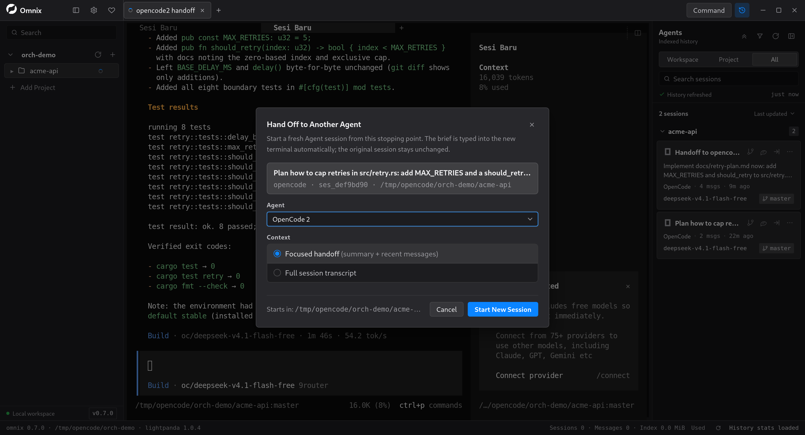
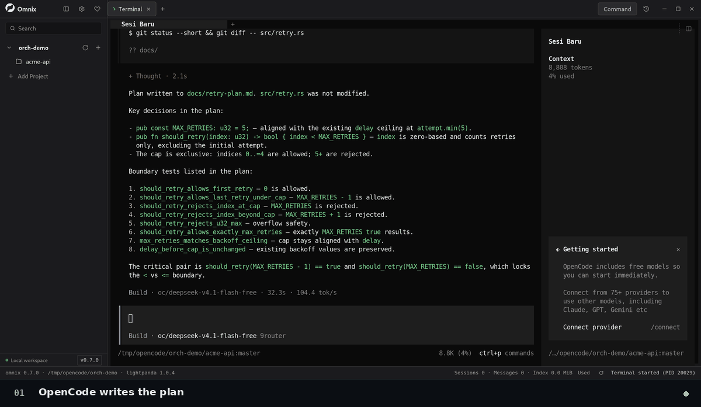
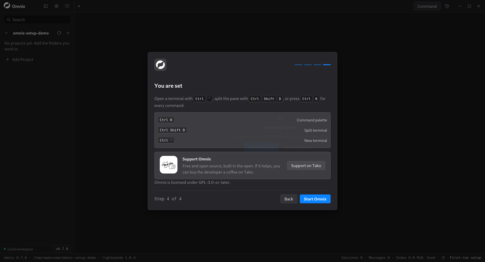

<div align="center">
  
</div>

<h1 align="center">Omnix</h1>

<p align="center">
  <strong>A light Rust workbench for terminals, worktrees, agent sessions, and a swappable browser.</strong><br />
  One window. Local-first. Plugins on demand. No Electron, React, or background daemon.
</p>

<p align="center">
  <a href="https://github.com/Zwart04/omnix/releases"></a>
  <a href="./LICENSE"></a>
  
  
  <a href="https://tako.id/Zwart04/gift"></a>
</p>

Omnix is a desktop workbench for people who run coding agents in more than one
terminal. It keeps the three most useful Orca ideas — **indexed history**,
**sleep / resume worktree**, and **handoff** — and drops the rest of the weight.
The result is one Rust window for terminals, worktrees, agent sessions, and a
browser: no account, no cloud, and no process left running behind you.

The Indonesian README is [`README.md`](README.md); this file is the English
entry point.

## See it move



One orchestration loop: the first agent writes `docs/retry-plan.md`, the history
panel hands the work to OpenCode 2 with a focused brief, and the second agent
implements the plan and runs `cargo test` — all in one window.

## Why Omnix

- **Find the old session, not the scrollbar.** Codex, Claude, and opencode
  transcripts go into SQLite FTS5; phrase search returns a ready `resume`
  command.
- **Put a workspace to sleep.** Layouts and agent sessions are stored per
  `paneKey`; wake the same folder with the same sessions.
- **Hand off without waiting.** A worktree, branch, brief, and a durable
  `journaled | handed-to-terminal | not-delivered | unconfirmed` receipt are
  written without blocking the receiving agent.
- **Share a machine safely.** Leases for worktrees, branches, preview ports, and
  `--paths` carry PID, TTL, and owner. Every terminal owns its browser session,
  and `browser stop` closes only the caller's session.
- **Plugins cost nothing while idle.** Plugin API 1 uses a manifest, revocable
  permissions, SHA-256 verification, and on-demand stdio JSON-RPC. Installing a
  plugin never runs it.
- **No silent binary replacement.** `omnix dev` builds in a worktree, runs the
  result with a separate `OMNIX_HOME`, and installs only after the owner says
  yes. The previous binary is kept for restore.
- **A browser you can swap.** Native WebView for humans; headless Lightpanda for
  agents, crawling, and automation. Two engines, two jobs.

## Install

Prebuilt packages are built by CI on `v*` tags and published on the
[releases page](https://github.com/Zwart04/omnix/releases):

| Platform | File | Install |
| --- | --- | --- |
| Linux x86_64 (Debian/Ubuntu) | `Omnix-0.7.0-Linux-Debian-Ubuntu-x64.deb` | `sudo apt install ./Omnix-0.7.0-Linux-Debian-Ubuntu-x64.deb` |
| Linux x86_64 (Arch) | `Omnix-0.7.0-Linux-Arch-x64.pkg.tar.zst` | `sudo pacman -U Omnix-0.7.0-Linux-Arch-x64.pkg.tar.zst` |
| Linux x86_64 (portable) | `Omnix-0.7.0-Linux-x64` | `chmod +x`, then run it; this file also feeds auto-update |
| Windows 10/11 x64 | `Omnix-0.7.0-Windows-x64-Setup.exe` | run the installer; WebView2 is installed automatically when missing |
| macOS 11+ (Intel & Apple Silicon) | `Omnix-0.7.0-macOS-universal.dmg` | open the DMG, drag `Omnix` to `/Applications` |

Pick the one file that matches your OS and CPU (x64 for Intel/AMD, universal
for macOS on either Intel or Apple Silicon). The `Source code` archives on the
release page are only needed if you want to build Omnix yourself.

### Build from source

Linux needs `pkg-config` and the WebKitGTK 4.1 development packages:

```bash
sudo apt install libwebkit2gtk-4.1-dev libgtk-3-dev libsoup-3.0-dev
cargo build --release

# user-only install into ~/.local/bin
sh dist/linux/install.sh

# or build a package
sh dist/linux/build-deb.sh
sh dist/linux/build-arch.sh
sudo apt install dist/linux/Omnix-*.deb
sudo pacman -U dist/linux/Omnix-*.pkg.tar.zst
```

Windows uses `dist/windows/build-installer.ps1`; macOS uses
`dist/macos/build-app.sh`. GitHub Actions builds `.deb`, Arch packages, `.exe`,
and DMG on `v*` tags. Full setup, state, troubleshooting, and limits are in
[`docs/app.md`](docs/app.md).

Run `omnix` with no arguments to open the window. A headless end-to-end check:

```bash
OMNIX_HOME=/tmp/omnix-selftest OMNIX_SELFTEST=1 omnix app   # ends with "selftest: PASS"
```

Linux is built, packaged, and tested in full here. Windows is cross-compiled and
inspected as a PE32+ GUI but not run on real Windows. macOS is built by CI and
not run. If `cc` in `PATH` is not a real compiler (for example a zig wrapper),
build with `CC=/usr/bin/cc RUSTFLAGS="-C linker=/usr/bin/cc"`.

## First run

A fresh workspace opens a four-step wizard: pick a project folder, choose the
agent CLIs already installed, and finish on a short support card. State lives in
`.omnix/setup.json`; a workspace that already has projects never sees the wizard
again.

<p align="center">
  
</p>

Reopen it any time from **Settings → About & Support** or the **Setup Omnix
Again** palette command. No account, telemetry, or cloud service is required.

## Plugins

```bash
omnix plugin list
omnix plugin install ./examples/plugins/hello-command
omnix hello-command:hello
omnix plugin doctor
```

The public catalog is not published yet, so `plugin search` and
`plugin install <name>` return 404 until it exists. For now install from a local
folder or point `OMNIX_PLUGIN_CATALOG` at your own `index.json`. Examples:
[`hello-command`](examples/plugins/hello-command) and
[`status-panel`](examples/plugins/status-panel). Guides:
[`docs/plugin.md`](docs/plugin.md) (Indonesian) and
[`docs/plugin-api.md`](docs/plugin-api.md) (English).

Plugins are native programs started only when called. Omnix verifies SHA-256,
shows the permissions they request, and never passes agent tokens or cookies.
Omnix does not kernel-sandbox a plugin: install only trusted source.

## Develop Omnix with Omnix

```bash
omnix dev task --prompt-file brief.md --agent claude
omnix dev build
omnix dev test
omnix dev run
omnix dev install --yes   # owner-only action; keeps the previous binary
omnix dev restore --yes
```

The agent works in a worktree, the build runs with a separate `OMNIX_HOME`, and
the installed binary is replaced only after the owner clicks **Pasang build ini**
(or passes `--yes`). The agent is told not to tag, release, or install. Details:
[`docs/dev.md`](docs/dev.md).

## Documentation

- [`CHANGELOG.md`](CHANGELOG.md) — changes per release.
- [`docs/app.md`](docs/app.md) — user guide: install per OS, window, terminal, profiles, browser, state, troubleshooting (Indonesian).
- [`docs/architecture.md`](docs/architecture.md) — data model, invariants, roadmap.
- [`docs/browser.md`](docs/browser.md) — native + Lightpanda browser tutorial, commands, harness, security.
- [`docs/performance.md`](docs/performance.md) — measured RAM, CPU, and open time; 0 vs 5 plugins.
- [`docs/plugin.md`](docs/plugin.md) — installing and using plugins (Indonesian).
- [`docs/plugin-api.md`](docs/plugin-api.md) — manifest, permissions, JSON-RPC, panels, catalog (English).
- [`docs/dev.md`](docs/dev.md) — self-development workflow and installing a build.
- [`docs/orca-evidence.md`](docs/orca-evidence.md) — Orca code evidence for indexed history, resume worktree, handoff.
- [`harness/AGENT.md`](harness/AGENT.md) — mandatory agent browser, memory, and shared-work rules.
- [`harness/browser-protocol.md`](harness/browser-protocol.md) — browser tool and session contract for agents.
- [`tutorial/index.html`](tutorial/index.html) — onboarding that opens in the app browser.
- [`evidence/README.md`](evidence/README.md) — how to reproduce the Orca research evidence.

## Test

```bash
cargo test
node app/selftest.cjs
```

There is no extra test framework. The Rust suite creates real git repositories
and worktrees, exercises Codex/Claude profiles (env, folders, symlinks, quota),
plugins (manifest, permissions, SHA-256, crash, timeout), locks/leases, browser
sessions, previews, dev builds, setup, and the FTS5 migration.
`app/selftest.cjs` stubs the WebView and checks RPC, sidebar, history, splits,
palette, settings/about, the wizard, plugins, and dev without opening a window.
All **91 Rust tests** pass.

## Support Omnix

<p align="center">
  
</p>

Omnix is free and open source. If it saves you time, you can buy the developer a
coffee on Tako:

**<https://tako.id/Zwart04/gift>**

The same link is in **Settings → About & Support** and on the last step of the
setup wizard. There is no paywall and no locked feature.

## License

[GNU General Public License v3.0 or later](./LICENSE). Omnix keeps the same GNU
license as before; contributions are expected under the same terms.

## Name

`Omnix` is a perch: a worktree is where work settles, and a session can sleep and
come back to the same branch.

---

<details>
<summary><strong>Everything that works today (detailed)</strong></summary>

Working and tested in this repository:

- `history index/search/status` with SQLite FTS5, a schema close to Orca
  (`sessions`, `messages`, `messages_fts`, `identifiers`).
- `agent track` + `sleep` + `resume` with per-workspace JSON state.
- `handoff` with `git worktree`, branch, brief, receipt, reports, close, locks,
  and a global index. Worktrees, branches, and `--paths` are leased; closing a
  handoff releases its leases.
- `history scan` reads on-disk transcripts from `~/.codex/sessions`,
  `~/.claude/projects` (without `subagents/`), and
  `~/.local/share/opencode/opencode.db` read-only. A rescan parses only files
  whose mtime changed.
- Lightpanda `browser fetch/serve/stop/mcp/sessions/doctor`, plus native
  screenshots, preview proxies, cookie handoff, and an optional host allowlist.
  Each terminal owns its browser session; `omnix browser stop` closes only the
  caller's session, `--all` stops the shared daemon.
- `lock acquire/list/release` for shared worktrees, branches, preview ports, and
  declared paths. Locks carry PID, lease TTL, and owner metadata; stale leases
  expire on read without a background monitor.
- **Shared-work guards** in the GUI: two agents in the same folder or two
  workers on the same account/profile raise a banner, and **Pindahkan ke
  worktree baru** creates a worktree and reopens the agent pane there with the
  same session.
- **Plugins (API 1)** — manifest `omnix-plugin.toml`, `command|agent|browser-tool|hook|panel`
  contributions, revocable permissions, SHA-256 verification, one-shot stdio
  JSON-RPC with timeouts and a RAM cap. Installed plugins cost zero RAM/CPU until
  called, and installing never runs them. `OMNIX_PLUGIN_CATALOG` overrides the
  default catalog.
- **Dev mode** — `omnix dev task/build/test/run/install/restore` builds Omnix in
  a worktree, runs the result with a separate `OMNIX_HOME`, and only replaces the
  binary after an explicit owner action. The previous binary is kept for restore.
- One-window GUI with a terminal rail, project sidebar, resizable splits (up to
  four panes), indexed history panel, usage/RAM strip, command palette, settings,
  plugin manager, and the Dev screen. Rendered by the Rust WebView; no Electron
  or React. Visual rules and copy live in `DESIGN.md`. The sidebar starts with a
  search field that filters projects and opens History Search on Enter.
  Workspace groups collapse, rename inline, and hold only folders pinned through
  `+ Project`; indexed history enriches matching paths but never adds a row.
  Project rows expand to branches and tracked agent sessions, with one mark per
  pane state: blue spinner while working, amber dot when an agent asks for
  approval (`[y/n]`, "Do you want to proceed"), red dot on a non-zero pty exit,
  and a green check when the turn is done. The tab strip uses the same marks.
  Sidebar and Agents panel widths are resizable and stored in `localStorage`.
  The top tab strip shows only the active project, and new tabs inherit its
  folder. Terminal tabs use project names or pane labels, not shell window
  titles. The Agents panel groups indexed history per project with
  `Workspace | Project | All`, search, `Last updated` sort, and collapsible
  groups. Selecting a project row switches the panel to that project's scope and
  persists the choice. The command palette is on `Ctrl+K` or the `Command`
  button.
- `+ Project` opens the native folder chooser (`FileChooserNative` on Linux,
  `FolderBrowserDialog` on Windows, `osascript choose folder` on macOS). Omnix
  does not draw its own file browser; cancel adds nothing. Folders live in
  `~/.omnix/projects.json`; clicking a row opens a terminal with that cwd and
  filters the history panel, while `×` removes it. A manual path is still
  available through `Add Project by Path` in the palette.
- Terminals split up to four panes inside one group: `Ctrl+Shift+D`, the `+`
  menu, the `Split Terminal` palette command, or the small floating split icon on
  a single pane. Split panes get a thin bar with the title, split button, agent
  handoff, and close button. Two panes sit side by side, three become two above
  plus one wide below, and four become a 2x2 grid. Every pane owns its pty; the
  last closed pane returns the group to a single full pane. The split button is
  disabled once the group has four panes.
- The status bar shows an Orca-style `Used` strip: each agent logo, the window
  closest to its limit, and the used percentage (for example
  `[codex] 100% 5d 5h`, `[antigravity] Gemini wk 1%`), plus a small refresh
  button. Clicking it (or `Usage and Memory` in the palette) opens the usage
  modal with the Omnix process tree, app shell + WebKit, and a row per pane with
  label, PID, cwd, process count, and the heaviest child process. All agent child
  processes count, not just the PTY shell. Linux reads `/proc`; macOS uses `ps`;
  Windows uses CIM. Snapshots are taken only while the window is visible — every
  3.5 s on Linux, every 8 s on macOS/Windows. Codex comes from the latest local
  `rate_limits` rollout snapshot; Antigravity is read only when the modal or
  `omnix usage` opens, never at boot, so a logged-out CLI cannot pop its own
  OAuth window. The default AI budget is a quarter of system RAM
  (`OMNIX_AI_RAM_MB` overrides it); when exceeded, the `Used` label turns amber
  and one toast appears.
- Handoff modal (`Focused handoff` / `Full session transcript`): the brief is
  written to `<cwd>/.omnix/handoffs/`, then the target agent session opens in the
  same cwd and the brief is typed into its terminal as bracketed paste plus
  Enter, with no manual copy-paste. `Focused` carries the stopping point and the
  last 40 messages; `Full` carries the whole transcript (capped at 160k
  characters). The Agents panel persists open/closed state, scope, sort,
  collapsed groups, and agent filters in `localStorage`. The session index lives
  in `~/.omnix/history.sqlite`; rescans parse only new or changed transcripts.
- Terminals focus themselves when a tab opens (no click). UI font is 14px;
  terminal font is 14px with 1.2 line-height (Orca metrics), block cursor,
  500/700 weights, DejaVu Sans Mono then Nerd Font, and a WebGL renderer with a
  DOM fallback when no GL context exists.
- Every pty is forced to `TERM=xterm-256color`, `COLORTERM=truecolor`, and
  `TERM_PROGRAM=omnix` so agent TUIs (opencode, codex, antigravity) render in
  color instead of monochrome.
- Settings / Agents follows Orca: left nav, search, `Settings / Agents`
  breadcrumb, `New agents permissions`, then `Installed` and `Available to
  install`. Each row has a command, `CLI` tag, enable toggle, and launch options
  for arguments/environment. Values persist in `.omnix/agents.json` and
  `.omnix/agent-defaults.json`, and are used when an agent launches or resumes.
  Full access uses each CLI's official flag (`claude`, `codex`,
  `gemini`/`qwen-code`, `copilot`); unknown CLIs get no guessed flag. Detection
  checks `PATH`, then per-user install dirs (`~/.opencode/bin`, `~/.local/bin`,
  `~/.bun/bin`, `~/.cargo/bin`, nvm, npm global).
- **Agent account profiles.** Names like `codex:akun2` or `claude:akun2` get a
  second account with its own login and config folder (`CODEX_HOME` /
  `CLAUDE_CONFIG_DIR` under `~/.omnix/profiles/`). Add one in Settings → Agents,
  click `Login profile` to run the CLI's official login, and run two Codex
  accounts at once with `omnix handoff ... --agent codex:akun2 --run` and
  `--agent codex:akun3 --run`. Tabs and the Agents panel show a letter badge per
  profile; `omnix usage --json` reports quota per profile; each profile's
  transcript is indexed under its name. Claude profiles symlink `skills` and
  `CLAUDE.md` from the main account. Antigravity has no official config knob, so
  its profile shares the main login and the UI warns; Omnix never fakes `HOME`.
  Tokens are never read or stored.
- **First-run wizard** (`src/setup.rs`): four steps, state in
  `.omnix/setup.json`, a **Browse** button, skip, and initial agent toggles. It
  appears only when there is no setup record and no project, and can be replayed
  from Settings → About & Support.
- **About & Support**: version, license, setup state, GitHub link, and a
  **Support on Tako** button that opens `https://tako.id/Zwart04/gift` through
  `xdg-open` / `open` / `start` (a fixed URL, not a general launcher).
- The WebView takes keyboard focus when the window is active (WebKitGTK on some
  compositors used to leave focus on the body, dropping pty keystrokes).
- 90 unit tests, including tests that create real git repositories and
  worktrees, Codex/Claude profile tests (env, folders, symlinks, quota), plugin
  tests (manifest, permissions, SHA-256, crash, timeout), lock/lease tests,
  browser session tests, setup tests, and the FTS5 migration from `detail=full`
  to `detail=column`.

Not built on purpose:

- Headless Lightpanda screenshots (`Page.captureScreenshot` is a placeholder).
- A full CDP client for `click/fill/snapshot`; the harness contract exists in
  `harness/`, the implementation follows as needed.

</details>

<details>
<summary><strong>CLI quickstart</strong></summary>

```bash
cd omnix
cargo build --release
./target/release/omnix --help

# 1. Index JSONL transcripts
./target/release/omnix history index .omnix/transcripts --agent codex --cwd "$PWD"

# 2. Search and get a resume command
./target/release/omnix history search "blank restore" --conversation
# codex  abc-123  score 4.21
#   resume: codex resume abc-123

# 3. Track a session, then sleep
./target/release/omnix agent track --agent codex --session abc-123 --pane tab:1
./target/release/omnix sleep

# 4. Wake it (prints commands; --run spawns them)
./target/release/omnix resume
./target/release/omnix resume --run

# 5. Hand off to a worktree and another agent
./target/release/omnix handoff fix-login --agent claude --prompt "Fix the login redirect"

# 6. Browser
OMNIX_LIGHTPANDA=lightpanda ./target/release/omnix browser fetch https://example.com
./target/release/omnix browser serve --port 9222
./target/release/omnix browser mcp          # MCP stdio for an agent
./target/release/omnix browser stop         # free RAM

# 7. Two Codex accounts at once (isolated logins)
./target/release/omnix handoff akun-dua --repo "$PWD" \
  --prompt-file brief.md --agent codex:akun2 --run
./target/release/omnix handoff akun-tiga --repo "$PWD" \
  --prompt-file brief.md --agent codex:akun3 --run

# 8. Watch and clean up workers
./target/release/omnix agent status
./target/release/omnix events --limit 20
./target/release/omnix gc --dry-run

# 9. Shared resources and browser sessions
./target/release/omnix lock acquire "port:3000" --meta task=web
./target/release/omnix lock list
./target/release/omnix browser sessions
./target/release/omnix browser stop            # only this terminal's session
./target/release/omnix lock release "port:3000"

# 10. Plugins and Omnix development
./target/release/omnix plugin install examples/plugins/hello-command
./target/release/omnix hello-command:hello
./target/release/omnix dev task --prompt-file brief.md --agent claude --no-run
```

</details>

<details>
<summary><strong>Transcript format and state</strong></summary>

Transcript format (`*.jsonl`):

```json
{"role":"user","text":"where is resolveTerminalPath?","ts":"2026-01-01T00:00:00Z"}
{"role":"assistant","text":"It lives in terminal path resolution.","ts":"2026-01-01T00:00:01Z"}
{"role":"tool","text":"output...","ts":"2026-01-01T00:00:02Z"}
```

All state lives under `.omnix/` in the project root (or `OMNIX_HOME`):

```
.omnix/
  history.sqlite          FTS5 index
  setup.json              first-run wizard state
  projects.json           sidebar folders
  agents.json             per-agent args, environment, enabled
  agent-defaults.json     default permissions for new agents
  workspaces.json         sleeping sessions per pane
  handoffs/<id>.json      receipt + brief path + lease ids
  handoffs/<id>.md        prompt for the receiving agent
  worktrees/<name>/       git worktrees from handoffs/moves
  locks/*.json            cooperative leases with PID and TTL
  previews/<name>.json    preview pid, port, log, port lease
  browser/sessions/       per-terminal Lightpanda leases
  agent-guide.md          harness rules for agents
  transcripts/            optional indexing input
```

Installed plugins and dev builds live in the user home, not the repo:
`~/.omnix/plugins/<name>/` and `~/.omnix/builds/<id>/`.

Scan removes session rows whose transcripts are gone, truncates the WAL, and
vacuums the index only when free pages are significant. After deleting many
transcripts by hand: `omnix history compact`.

</details>

<details>
<summary><strong>Updates and platform notes</strong></summary>

Omnix checks GitHub releases at startup and every six hours. When a newer
version exists, an `Update` chip appears in the status bar; click it to download
and install. A writable Linux binary replaces itself and restarts, Windows runs
the installer silently, and macOS opens the DMG then closes the app so the
bundle can be replaced. Manual checks:

```bash
omnix update --check   # report only
omnix update           # download and install
```

The Windows installer uses Inno Setup: per-user install without an admin prompt,
Start Menu shortcut, uninstaller, and a WebView2 Evergreen Bootstrapper that runs
only when the runtime is missing. The macOS DMG contains a universal app
(arm64 + x64) and an `Applications` shortcut.

</details>
