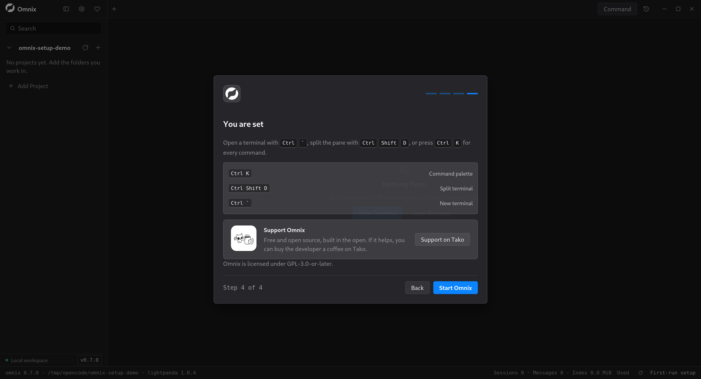

<div align="center">
  
</div>

<h1 align="center">Omnix</h1>

<p align="center">
  <strong>Worktree, sesi agent, dan browser dalam satu workbench Rust yang ringan.</strong><br />
  Satu jendela. Local-first. Plugin hanya saat dipanggil. Tanpa Electron, React, atau daemon latar.
</p>

<p align="center">
  <a href="https://github.com/Zwart04/omnix/releases"></a>
  <a href="./LICENSE"></a>
  
  
  <a href="https://tako.id/Zwart04/gift"></a>
</p>

Omnix adalah workbench desktop untuk orang yang menjalankan coding agent di
lebih dari satu terminal. Ia mengambil tiga ide Orca yang paling berguna —
**indexed history**, **sleep/resume worktree**, dan **handoff** — lalu membuang
sisa bobotnya. Hasilnya satu jendela Rust yang membuka terminal, worktree, sesi
agent, dan browser tanpa akun, tanpa cloud, dan tanpa proses yang terus hidup
di belakang.

## Lihat cara kerjanya


Satu putaran orkestrasi: agent pertama menulis `docs/retry-plan.md`, panel
riwayat membuka handoff ke OpenCode 2 dengan brief terfokus, lalu agent kedua
mengimplementasikan rencana dan menjalankan `cargo test` — semuanya di satu
jendela.

## Kenapa Omnix

- **Cari sesi lama, bukan scroll.** Transkrip Codex, Claude, dan opencode masuk
  SQLite FTS5; pencarian per frasa langsung memberi perintah `resume`.
- **Tidurkan workspace.** Layout dan sesi disimpan per `paneKey`; bangun lagi
  dengan agent yang sama di folder yang sama.
- **Handoff yang tidak menunggu.** Worktree, branch, brief, dan receipt
  `journaled | handed-to-terminal | not-delivered | unconfirmed` dibuat tanpa
  menahan agent penerima.
- **Aman untuk kerja bersama.** Lease worktree, branch, port preview, dan
  `--paths` membawa PID, TTL, dan owner. Tiap terminal punya sesi browser
  sendiri; `browser stop` hanya menutup milik pemanggil.
- **Plugin tanpa biaya diam.** Plugin API 1 memakai manifest, izin yang bisa
  dicabut, verifikasi SHA-256, dan stdio JSON-RPC saat dipanggil. Instalasi
  tidak pernah menjalankan plugin.
- **Build tidak menimpa diam-diam.** `omnix dev` membangun di worktree,
  menjalankan hasilnya dengan `OMNIX_HOME` terpisah, dan hanya memasang binary
  setelah kamu setujui. Binary sebelumnya disimpan.
- **Browser yang bisa diganti.** WebView native untuk manusia; Lightpanda
  headless untuk agent, crawling, dan automation. Dua engine, dua peran.

## Pasang

Paket siap pasang dibangun CI pada tag `v*` dan tersedia di
[halaman rilis](https://github.com/Zwart04/omnix/releases):

| Platform | Berkas | Cara pasang |
| --- | --- | --- |
| Linux x86_64 (Debian/Ubuntu) | `Omnix-0.8.0-Linux-Debian-Ubuntu-x64.deb` | `sudo apt install ./Omnix-0.8.0-Linux-Debian-Ubuntu-x64.deb` |
| Linux x86_64 (Arch) | `Omnix-0.8.0-Linux-Arch-x64.pkg.tar.zst` | `sudo pacman -U Omnix-0.8.0-Linux-Arch-x64.pkg.tar.zst` |
| Linux x86_64 (portable) | `Omnix-0.8.0-Linux-x64` | `chmod +x`, lalu jalankan; berkas ini juga dipakai auto-update |
| Windows 10/11 x64 | `Omnix-0.8.0-Windows-x64-Setup.exe` | jalankan installer; WebView2 dipasang otomatis bila belum ada |
| macOS 11+ (Intel & Apple Silicon) | `Omnix-0.8.0-macOS-universal.dmg` | buka DMG, seret `Omnix` ke `/Applications` |

Pilih satu berkas sesuai OS dan prosesor (x64 untuk Intel/AMD, universal
untuk macOS Intel maupun Apple Silicon). Berkas `Source code` di halaman rilis
hanya diperlukan kalau kamu ingin membangun sendiri.

Build macOS ditandatangani ad-hoc dan belum dinotarisasi; kalau Gatekeeper
menolak, klik kanan `Omnix.app` lalu **Open**, atau jalankan
`xattr -dr com.apple.quarantine /Applications/Omnix.app`. Installer Windows
belum ditandatangani, jadi SmartScreen bisa menampilkan **More info → Run
anyway**.

### Build dari source

Linux membutuhkan `pkg-config` dan paket dev WebKitGTK 4.1:

```bash
sudo apt install libwebkit2gtk-4.1-dev libgtk-3-dev libsoup-3.0-dev
cargo build --release

# user-only, ke ~/.local/bin
sh dist/linux/install.sh

# atau paket Debian / Arch
sh dist/linux/build-deb.sh
sh dist/linux/build-arch.sh
sudo apt install dist/linux/Omnix-*.deb
sudo pacman -U dist/linux/Omnix-*.pkg.tar.zst
```

Windows memakai `dist/windows/build-installer.ps1`; macOS memakai
`dist/macos/build-app.sh`. GitHub Actions membangun `.deb`, paket Arch,
installer `.exe`, dan DMG pada tag `v*`. Panduan lengkap, termasuk state,
troubleshooting, dan batasan, ada di [`docs/app.md`](docs/app.md).

Jalankan `omnix` tanpa argumen untuk membuka jendela. Verifikasi end-to-end
tanpa screenshot:

```bash
OMNIX_HOME=/tmp/omnix-selftest OMNIX_SELFTEST=1 omnix app   # berakhir "selftest: PASS"
```

Linux sudah dibangun, dipaketkan, dan diuji penuh di mesin pengembang. Windows
di-cross-compile sebagai PE32+ GUI tetapi belum dijalankan di Windows
sungguhan. macOS dibangun oleh CI dan belum dijalankan. Kalau `cc` di `PATH`
bukan compiler sungguhan (misalnya wrapper zig), build dengan
`CC=/usr/bin/cc RUSTFLAGS="-C linker=/usr/bin/cc"`.

## Pertama kali dibuka

Workspace baru membuka wizard empat langkah: pilih folder project, pilih agent
CLI yang sudah terpasang, lalu selesai di kartu dukungan. State-nya disimpan di
`.omnix/setup.json`; workspace yang sudah punya project tidak akan melihat
wizard ini lagi.

<p align="center">
  
</p>

Jalankan ulang kapan saja dari **Settings → About & Support** atau palette
**Setup Omnix Again**. Tidak ada akun, telemetri, atau layanan cloud yang
dibutuhkan.

## Plugin

```bash
omnix plugin list
omnix plugin install ./examples/plugins/hello-command
omnix hello-command:hello
omnix plugin doctor
```

Katalog publik belum dipublikasikan, jadi `plugin search` dan
`plugin install <nama>` mengembalikan 404 sampai katalog itu ada. Untuk
sekarang, pasang dari folder lokal atau arahkan `OMNIX_PLUGIN_CATALOG` ke
`index.json` milikmu. Contoh:
[`hello-command`](examples/plugins/hello-command) dan
[`status-panel`](examples/plugins/status-panel). Panduan:
[`docs/plugin.md`](docs/plugin.md) (Indonesia) dan
[`docs/plugin-api.md`](docs/plugin-api.md) (Inggris).

Plugin adalah program native yang dijalankan saat dipanggil. Omnix memverifikasi
SHA-256, menampilkan izin yang diminta, dan tidak pernah memberikan token agent
atau cookie. Omnix tidak melakukan kernel sandbox, jadi pasang hanya dari sumber
yang dipercaya.

## Kembangkan Omnix dengan Omnix

```bash
omnix dev task --prompt-file brief.md --agent claude
omnix dev build
omnix dev test
omnix dev run
omnix dev install --yes   # aksi pemilik; binary lama disimpan
omnix dev restore --yes
```

Agent bekerja di worktree, build berjalan dengan `OMNIX_HOME` terpisah, dan
binary yang terpasang hanya diganti setelah pemilik menekan **Pasang build ini**
(atau memberi `--yes`). Agent diberi tahu untuk tidak menandai tag,
mempublikasikan rilis, atau memasang. Detail: [`docs/dev.md`](docs/dev.md).

## Dokumentasi

- [`CHANGELOG.md`](CHANGELOG.md) — riwayat perubahan per rilis.
- [`docs/app.md`](docs/app.md) — panduan pengguna: instalasi per OS, jendela, terminal, profil akun, browser, state, troubleshooting.
- [`docs/architecture.md`](docs/architecture.md) — model data, invariant, roadmap.
- [`docs/browser.md`](docs/browser.md) — tutorial lengkap browser native + Lightpanda, command, harness, keamanan.
- [`docs/performance.md`](docs/performance.md) — hasil ukur RAM, CPU, waktu buka; 0 vs 5 plugin.
- [`docs/plugin.md`](docs/plugin.md) — memasang dan memakai plugin (Indonesia).
- [`docs/plugin-api.md`](docs/plugin-api.md) — manifest, izin, JSON-RPC, panel, katalog (Inggris).
- [`docs/dev.md`](docs/dev.md) — alur **Kembangkan Omnix** dan pemasangan build.
- [`docs/orca-evidence.md`](docs/orca-evidence.md) — bukti kode Orca untuk indexed history, resume worktree, handoff.
- [`harness/AGENT.md`](harness/AGENT.md) — aturan wajib agent: Lightpanda, tab, RAM, dan kerja bersama.
- [`harness/browser-protocol.md`](harness/browser-protocol.md) — kontrak tool browser dan sesi untuk agent.
- [`tutorial/index.html`](tutorial/index.html) — onboarding yang bisa dibuka di browser bawaan aplikasi.
- [`evidence/README.md`](evidence/README.md) — cara mereproduksi bukti riset Orca.

## Test

```bash
cargo test
node app/selftest.cjs
```

Tidak ada framework test tambahan. Suite Rust membuat git repo dan worktree
sungguhan, menguji profil Codex/Claude (env, folder, symlink, kuota), plugin
(manifest, izin, SHA-256, crash, timeout), lock/lease, sesi browser, preview,
dev build, setup, dan migrasi FTS5. `app/selftest.cjs` men-stub WebView lalu
memeriksa RPC, sidebar, history, split pane, palette, settings/about, wizard,
plugin, dan dev tanpa membuka jendela. Saat ini **91 test Rust** lulus.

## Dukung Omnix

<p align="center">
  
</p>

Omnix gratis dan open source. Kalau ia menghemat waktumu, kamu bisa mentraktir
developer secangkir kopi di Tako:

**<https://tako.id/Zwart04/gift>**

Tautan yang sama ada di **Settings → About & Support** dan di langkah terakhir
wizard. Tidak ada paywall dan tidak ada fitur yang dikunci.

## Lisensi

[GNU General Public License v3.0 or later](./LICENSE). Omnix tetap memakai
lisensi GNU seperti sebelumnya; kontribusi dianggap membawa lisensi yang sama.

## Nama

`Omnix` = tempat burung bertengger. Pendek, bahasa Inggris, tidak metaforis
berlebihan: worktree adalah tempat kerja bertengger, sesi bisa tidur dan kembali
ke ranting yang sama.

---

<details>
<summary><strong>Semua yang sudah jalan (detail)</strong></summary>

Yang sudah jalan dan dites di repo ini:

- `history index/search/status` dengan SQLite FTS5, skema mirip Orca (`sessions`, `messages`, `messages_fts`, `identifiers`).
- `agent track` + `sleep` + `resume` dengan state JSON per workspace.
- `handoff` yang membuat `git worktree`, branch, brief, dan receipt `journaled | handed-to-terminal | not-delivered | unconfirmed`.
- `history scan` yang membaca langsung transkrip di disk: `~/.codex/sessions`,
  `~/.claude/projects` (tanpa `subagents/`), dan `~/.local/share/opencode/opencode.db`
  read-only. Rescan hanya mem-parse berkas yang mtime-nya berubah.
- `browser fetch/serve/stop/mcp/sessions/doctor` untuk backend Lightpanda; `diagnostics memory` untuk snapshot RAM proses (tree app bila dijalankan dari terminal Omnix). Setiap terminal punya sesi browser sendiri: `browser stop` hanya menutup sesi pemanggil, `--all` menghentikan daemon bersama. Native screenshot, preview proxy, cookie handoff, dan allowlist host mengikuti kontrak di `harness/`.
- `lock acquire/list/release` untuk worktree, branch, port preview, dan `--paths`. Lease membawa PID, TTL, dan owner; lease mati atau kedaluwarsa dibersihkan saat daftar dibaca, tanpa monitor latar belakang. `handoff` mengambil lease otomatis dan melepasnya saat `handoff close`; `preview start` memilih port bebas dan mencatat `port:<n>`.
- Peringatan **Kerja bersama** di GUI: dua agent di folder yang sama atau dua worker dengan akun/profil yang sama memunculkan banner, dan **Pindahkan ke worktree baru** membuat worktree lalu membuka ulang pane agent di sana dengan sesi yang sama.
- **Plugin API 1**: manifest `omnix-plugin.toml`, kontribusi `command|agent|browser-tool|hook|panel`, izin yang bisa dicabut, verifikasi SHA-256, runtime stdio JSON-RPC satu kali dengan timeout dan batas RAM. Plugin yang tidak dipanggil tidak memakai RAM/CPU, dan instalasi tidak pernah menjalankannya. Katalog publik bisa ditimpa lewat `OMNIX_PLUGIN_CATALOG`.
- **Kembangkan Omnix**: `omnix dev task/build/test/run/install/restore` membuat worktree, menjalankan hasil build dengan `OMNIX_HOME` terpisah, dan hanya mengganti binary setelah pemilik menekan **Pasang build ini**; binary sebelumnya disimpan untuk **Kembalikan**. Agent tidak menandai tag atau mempublikasikan rilis.
- GUI satu jendela minimalis: satu bar atas berisi brand, tab, `+`, dan tombol
  `Command`; chrome solid, radius kecil, satu aksen biru. Tetap dirender
  WebView Rust tanpa Electron/React. Aturan visual dan copy ada di `DESIGN.md`.
  Sidebar mulai dengan search field: mengetik memfilter project, Enter membuka
  History Search dengan query yang sama. Grup workspace bisa dilipat dan
  judulnya diganti langsung; aksi refresh dan `+ Project` ada di baris judulnya,
  sedangkan collapse sidebar, Settings, dan toggle Agents tinggal di bar jendela. Grup itu hanya berisi folder yang kamu pin lewat `+ Project`;
  indexed history cuma memperkaya baris yang path-nya cocok, tidak menambah
  folder. Baris project satu baris; twisty membuka branch dan sesi agent yang
  terlacak, dan satu mark menandai keadaan pane: spinner biru saat bekerja,
  titik amber saat agent minta persetujuan (`[y/n]`, "Do you want to proceed"),
  titik merah saat pty keluar non-zero, dan centang hijau saat giliran selesai.
  Tab atas memakai mark yang sama, jadi status terlihat tanpa membuka pane.
  Sidebar dan panel `Agents` bisa di-resize lewat tepinya (drag, panah saat
  fokus, double-click untuk reset); lebarnya disimpan di `localStorage` dan
  tidak berubah saat collapse/expand. Tab atas hanya berisi tab
  project yang aktif: klik project lain menukar strip, bukan menumpuk tab.
  Tab baru, termasuk agent dari menu `+`, mewarisi folder tab aktif. Tab
  memakai nama project atau label pane, bukan judul window shell, supaya dua
  terminal di folder berbeda tidak tampil identik. Panel `Agents` berisi
  indexed history semua agent, dikelompokkan per project, dengan segmented
  control `Workspace | Project | All`, search, sort `Last updated`, dan grup
  yang bisa dilipat. Memilih satu baris project di sidebar otomatis memindah
  panel ke scope `Project` untuk folder itu, jadi yang tampil hanya history
  project tersebut (termasuk subfoldernya), dan pilihannya bertahan saat
  aplikasi dibuka lagi. Command palette ada di Ctrl+K atau tombol `Command`.
- `+ Project` membuka dialog folder bawaan OS lewat `FileChooserNative` (Linux,
  tampil sesuai desktop portal), `FolderBrowserDialog` di Windows, dan
  `osascript choose folder` di macOS. Omnix tidak menggambar file browser
  sendiri; batal berarti tidak ada folder yang ditambah. Folder disimpan di
  `~/.omnix/projects.json`, klik satu baris membuka terminal dengan cwd di sana
  sekaligus memfilter panel history ke folder itu, dan `×` di baris
  menghapusnya dari sidebar. Path manual tetap tersedia lewat
  `Add Project by Path` di palette. Indexed history hanya mengisi jumlah sesi
  dan logo agent untuk path yang cocok, tidak menambah baris.
- Terminal bisa di-split sampai empat pane dalam satu grup: `Ctrl+Shift+D`,
  menu `+`, palette `Split Terminal`, atau ikon split kecil yang mengambang di
  pojok kanan atas pane tunggal. Begitu pane menjadi split, tiap pane mendapat
  bar tipis di atasnya berisi judul, tombol split, hand off ke
  agent, dan tombol silang untuk menutup pane itu. Pill mengambang disembunyikan
  saat bar aktif; pada pane tunggal pill tetap bisa digeser lewat grip dan
  double-click untuk kembali ke pojok. Dua pane tampil berdampingan, tiga pane
  jadi dua di atas plus satu lebar di bawah, empat pane jadi grid 2x2. Tiap pane
  punya pty sendiri; tombol close di tab strip atau silang di bar menutup pty
  itu dan pane terakhir kembali menjadi satu pane penuh. Tombol split
  dinonaktifkan saat grup sudah berisi empat pane.
- Status bar menampilkan strip `Used` ala Orca: logo tiap agent, window yang
  paling dekat limitnya, dan persen terpakai (misalnya `[codex] 100% 5d 5h`,
  `[antigravity] Gemini wk 1%`), plus tombol refresh kecil di ujungnya. Klik
  bagian `Used` (atau palette `Usage and Memory`) untuk modal usage: total
  process tree Omnix, bagian app shell + WebKit, dan baris per-pane berisi
  label, PID, cwd, jumlah proses, serta nama proses anak terberat. Semua child
  process agent ikut dihitung, bukan hanya shell PTY. Di Linux pembacaan
  langsung dari `/proc`; macOS lewat `ps`, Windows lewat CIM. Snapshot hanya
  diambil saat jendela terlihat: tiap 3,5 detik di Linux (baca `/proc` murah),
  8 detik di macOS/Windows (hindari spawn proses polling terlalu sering). Modal
  yang sama tetap menampilkan memori sistem dan limit per agent, bukan total
  token. Codex dibaca dari snapshot `rate_limits` terakhir di rollout lokal;
  Antigravity hanya dibaca saat modal Usage atau `omnix usage` dibuka, tidak
  pernah saat boot, supaya CLI yang belum login tidak memunculkan jendela OAuth
  sendiri. Tiap agent tampil sebagai
  satu baris: nama dan plan, window yang paling dekat limitnya (misalnya weekly
  atau 5 jam), hitungan reset, progress bar, dan persen terpakai. Provider tanpa
  data lokal tidak muncul. Budget AI default-nya seperempat RAM sistem
  (`OMNIX_AI_RAM_MB` untuk menimpanya); saat terlampaui label `Used` jadi amber
  dan muncul satu toast.
- Handoff modal ala Orca (`Focused handoff` / `Full session transcript`): brief
  ditulis ke `<cwd>/.omnix/handoffs/`, lalu sesi agent target dibuka di cwd yang
  sama dan brief itu langsung diketik ke terminalnya sebagai bracketed paste
  plus Enter, tanpa perlu copy-paste manual. `Focused` membawa ringkasan
  stopping point + 40 pesan terakhir; `Full` membawa seluruh transkrip (dibatasi
  160k karakter). Panel `Agents` mengikuti state terakhir: terbuka/tertutup, scope,
  sort, grup yang dilipat, dan filter agent disimpan di `localStorage`, jadi
  tidak hilang setelah aplikasi ditutup. Index sesi disimpan di
  `~/.omnix/history.sqlite`; rescan hanya mem-parse transkrip yang baru atau
  berubah, dan detailnya ada di tooltip baris status.
- Terminal fokus otomatis saat tab dibuka (tanpa klik), font UI 14px, dan
  terminal 14px / line-height 1.2 (metrik Orca) dengan cursor block, fontWeight
  500/700, font chain DejaVu Sans Mono lalu Nerd Font, dan renderer WebGL supaya
  glyph tetap tajam; fallback ke renderer DOM kalau konteks GL tidak ada.
- Setiap pty dipaksa `TERM=xterm-256color`, `COLORTERM=truecolor`,
  `TERM_PROGRAM=omnix` supaya TUI agent (opencode, codex, antigravity) tampil
  berwarna, bukan monokrom.
- Settings / Agents ala Orca (gear di header sidebar atau menu `+`): nav kiri,
  pencarian, breadcrumb `Settings / Agents`, pilihan `New agents permissions`,
  lalu daftar `Installed` dan `Available to install`. Tiap baris punya command,
  tag `CLI`, toggle enable, dan menu launch options untuk argumen/environment.
  Nilai tersimpan otomatis di `.omnix/agents.json` (per agent) dan
  `.omnix/agent-defaults.json` (permissions default), lalu dipakai saat agent
  diluncurkan atau di-resume. Full access memakai flag resmi tiap CLI
  (`claude`, `codex`, `gemini`/`qwen-code`, `copilot`); CLI yang tidak punya
  flag dikenal tidak diberi tebakan. Deteksi mencari `PATH` lalu direktori
  install per-user (`~/.opencode/bin`, `~/.local/bin`, `~/.bun/bin`,
  `~/.cargo/bin`, nvm, npm global).
- **Profil akun agent.** Nama seperti `codex:akun2` atau `claude:akun2` memberi
  akun kedua dengan login dan folder config sendiri (`CODEX_HOME` /
  `CLAUDE_CONFIG_DIR` di bawah `~/.omnix/profiles/`). Tambah dari Settings →
  Agents, klik `Login profile` untuk membuka alur login resmi CLI, dan dua akun
  Codex bisa jalan bersamaan lewat `omnix handoff ... --agent codex:akun2 --run`
  dan `--agent codex:akun3 --run`. Tab dan panel Agents menampilkan badge huruf
  berwarna per profil; `omnix usage --json` melaporkan kuota per profil;
  transkrip tiap profil ikut di-index dengan nama profilnya. Profil Claude
  menautkan `skills` dan `CLAUDE.md` dari akun utama lewat symlink. Antigravity
  belum punya knob config resmi, jadi profilnya berbagi login utama dan UI
  memberi peringatan; Omnix tidak memalsukan `HOME`. Token tidak pernah dibaca
  atau disimpan.
- **Wizard pertama kali** (`src/setup.rs`): empat langkah, state di
  `.omnix/setup.json`, tombol **Browse**, skip, dan pengaturan agent awal.
  Muncul hanya kalau belum ada setup dan belum ada project; bisa dijalankan
  ulang dari Settings → About & Support.
- **About & Support**: versi, lisensi, status setup, tautan GitHub, dan tombol
  **Support on Tako** yang membuka `https://tako.id/Zwart04/gift` lewat
  `xdg-open` / `open` / `start` (URL konstan, bukan launcher bebas).
- WebView mengambil fokus keyboard sendiri saat jendela aktif (WebKitGTK di
  compositor tertentu sempat membiarkan fokus di body, jadi ketikan pty hilang).
- 90 unit test, termasuk test yang membuat git repo dan worktree sungguhan,
  test profil Codex/Claude (env, folder, symlink, kuota), test plugin (manifest,
  izin, sha256, crash, timeout), test lock/lease, test sesi browser, test setup,
  dan test migrasi FTS5 dari `detail=full` ke `detail=column`.

Belum dibangun (sengaja, biar tidak jadi kerangka kosong):

- Headless screenshot Lightpanda: `Page.captureScreenshot` masih placeholder.
- CDP client penuh untuk `click/fill/snapshot`. Kontrak harness sudah ada di `harness/`, implementasinya menyusul.

</details>

<details>
<summary><strong>CLI quickstart</strong></summary>

```bash
cd omnix
cargo build --release
./target/release/omnix --help

# 1. Index transkrip JSONL
./target/release/omnix history index .omnix/transcripts --agent codex --cwd "$PWD"

# 2. Cari dan dapatkan resume command
./target/release/omnix history search "blank restore" --conversation
# codex  abc-123  score 4.21
#   resume: codex resume abc-123

# 3. Catat sesi agent ke workspace, lalu tidurkan
./target/release/omnix agent track --agent codex --session abc-123 --pane tab:1
./target/release/omnix sleep

# 4. Bangun lagi (cetak perintah; --run untuk spawn)
./target/release/omnix resume
./target/release/omnix resume --run

# 5. Handoff ke worktree + agent lain
./target/release/omnix handoff fix-login --agent claude --prompt "Fix the login redirect"

# 6. Browser
OMNIX_LIGHTPANDA=lightpanda ./target/release/omnix browser fetch https://example.com
./target/release/omnix browser serve --port 9222
./target/release/omnix browser mcp          # MCP stdio untuk agent
./target/release/omnix browser stop         # bebaskan RAM

# 7. Dua akun Codex bersamaan (login dipisah per profil)
./target/release/omnix handoff akun-dua --repo "$PWD" \
  --prompt-file brief.md --agent codex:akun2 --run
./target/release/omnix handoff akun-tiga --repo "$PWD" \
  --prompt-file brief.md --agent codex:akun3 --run

# 8. Pantau dan bersihkan worker
./target/release/omnix agent status
./target/release/omnix events --limit 20
./target/release/omnix gc --dry-run

# 9. Kerja bersama: lease resource dan sesi browser
./target/release/omnix lock acquire "port:3000" --meta task=web
./target/release/omnix lock list
./target/release/omnix browser sessions
./target/release/omnix browser stop            # hanya sesi terminal ini
./target/release/omnix lock release "port:3000"

# 10. Plugin dan pengembangan Omnix
./target/release/omnix plugin install examples/plugins/hello-command
./target/release/omnix hello-command:hello
./target/release/omnix dev task --prompt-file brief.md --agent claude --no-run
```

</details>

<details>
<summary><strong>Format transkrip dan state</strong></summary>

Format transkrip yang dibaca (`*.jsonl`):

```json
{"role":"user","text":"where is resolveTerminalPath?","ts":"2026-01-01T00:00:00Z"}
{"role":"assistant","text":"It lives in terminal path resolution.","ts":"2026-01-01T00:00:01Z"}
{"role":"tool","text":"output...","ts":"2026-01-01T00:00:02Z"}
```

Semua state ada di `.omnix/` di root project (atau `OMNIX_HOME`):

```
.omnix/
  history.sqlite          FTS5 index
  setup.json              status wizard pertama kali
  projects.json           folder yang ditampilkan di sidebar
  agents.json             argumen, environment, enabled per agent
  agent-defaults.json     permissions default (full access) untuk agent baru
  workspaces.json         sleeping sessions, per pane
  handoffs/<id>.json      receipt + brief path + lease ids
  handoffs/<id>.md        prompt untuk agent penerima
  worktrees/<name>/       git worktree hasil handoff/move
  locks/*.json            lease kooperatif (PID, TTL, owner)
  previews/<name>.json    pid, port, log, dan lease port preview
  browser/sessions/       lease Lightpanda per terminal
  agent-guide.md          aturan harness untuk agent
  transcripts/            input indexing (opsional)
```

Plugin terpasang dan build dev tinggal di home pengguna, bukan di repo:
`~/.omnix/plugins/<nama>/` dan `~/.omnix/builds/<id>/`.

Scan membersihkan baris sesi yang transkripnya sudah hilang, memotong WAL, dan
mem-vacuum index hanya kalau halaman bebasnya sudah signifikan. Untuk merapikan
setelah menghapus banyak transkrip secara manual: `omnix history compact`.

</details>

<details>
<summary><strong>Update dan catatan platform</strong></summary>

Omnix memeriksa rilis GitHub saat start dan tiap enam jam. Kalau ada versi baru,
chip `Update` muncul di status bar; klik untuk mengunduh dan memasang. Linux
dengan binary yang bisa ditulis mengganti dirinya lalu restart, Windows
menjalankan installer senyap, macOS membuka DMG lalu menutup aplikasi agar
bundle bisa diganti. Cek manual dari terminal:

```bash
omnix update --check   # hanya laporan
omnix update           # unduh dan pasang
```

Installer Windows memakai Inno Setup: instalasi per-user tanpa prompt admin,
shortcut Start Menu, uninstaller, dan WebView2 Evergreen Bootstrapper yang hanya
jalan kalau runtime belum terpasang. DMG macOS berisi aplikasi universal
(arm64 + x64) dan pintasan `Applications`.

</details>
